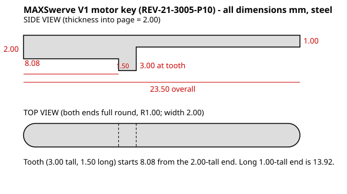

# MAXSwerve V1 motor key (REV-21-3005-P10) — make your own

REV no longer sells this key. Dimensions below were taken from REV's STEP model of the part.
All mm, steel.

| Section (from the 2 mm end) | Length | Height | Width |
|---|---|---|---|
| Main body (end rounded R1 in top view) | 8.08 | 2.00 | 2.00 |
| Tooth (sticks out 1 mm below the body) | 1.50 | 3.00 | 2.00 |
| Long thin tail (end rounded R1 in top view) | 13.92 | 1.00 | 2.00 |
| **Overall** | **23.50** | | |

The top edge is flat along the whole length. The tooth is what sits on the encoder bridge's lip
(REV: if it drops into the slot instead, the module won't work and the key gets damaged).

Files:
- `motor_key_side_profile.dxf`: the side profile as a closed outline (mm). Cut it from **2 mm
  thick steel** and the 2 mm width comes from the sheet thickness.
- `motor_key_drawing.svg`: the dimensioned drawing above.

A standard 2 × 2 mm key (AndyMark, McMaster) can't make this part: the tooth is 3 mm tall. Start
from 2 mm thick steel at least 3 mm wide instead, or have the DXF laser/waterjet cut from 2 mm
steel. Then round the ends with a file if the keyway ends are rounded, and file the width until
it slides into the shaft keyway with no play. Compare it against a key from one of your finished
modules before installing.
